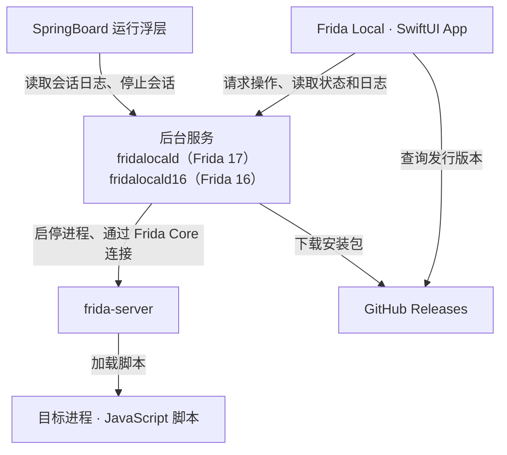

# Frida Local

Frida Local 是一款面向 Roothide iPhone 的本地 Frida 脚本工具。你可以直接在手机上管理 `frida-server`、运行 JavaScript 脚本，并查看调试日志。

## 主要功能

- **脚本库**支持导入 UTF-8 `.js` 文件、预览带语法高亮的源码，以及复制代码。
- **脚本会话**支持 Attach 到运行中的进程，或通过 Spawn 启动应用并加载脚本。
- **日志和运行浮层**显示脚本输出、异常和退出事件，支持 ANSI 颜色。浮层可拖动、调整背景透明度、切换日志显示方式，也可直接停止会话。
- **本地服务管理**支持启停 `frida-server`、配置监听地址与端口，以及下载和切换 Frida 16、17 的服务端版本。

## 使用演示

[观看 iPhone 实机演示（MP4，约 1 分 05 秒，9.3 MB）](docs/assets/frida-local-demo.mp4)

## 系统要求与安装

- iPhone 需运行 iOS 15.0 或更高版本，并具备 Roothide 环境。
- 使用设备上的 Roothide 兼容包管理器安装 `.deb`。按[源码构建](#源码构建)生成的安装包位于 `packages/`，文件名为 `dev.fridalocal_<版本>_iphoneos-arm64e.deb`。
- 安装或更新后，重启 SpringBoard（Respring）以加载运行浮层，再打开 **Frida Local**。安装程序会尝试启动服务，首次安装的默认监听地址是 `127.0.0.1:27042`。

## 快速开始

1. 打开「设置」，在「Frida Server」中确认服务正在运行。如有需要，点「启动服务」。
2. 在「脚本」页点「导入示例」。已有脚本时，可以通过右上角的 `+` 从「文件」导入 UTF-8 `.js`，例如仓库中的 [hello.js](examples/hello.js)。
3. 打开脚本，为自己的测试应用选择 **Attach**（应用已运行）或 **Spawn**（从头启动应用），再点「运行脚本」。
4. 在「日志」页查看输出。内置示例会输出加载消息、进程 ID 和架构。可在日志页或运行浮层中停止会话。

在脚本详情的「文件」区域点「查看」可预览源码。在「设置」的「运行浮层」区域，可以开关浮层并调整背景透明度。

## Frida 版本管理

打开「设置」中的「版本」，选择 **Frida 16** 或 **Frida 17**。每个系列缓存 10 个近期正式版本，可下拉刷新、搜索版本号或加载更早的版本。 [Frida 官方发行列表](https://github.com/frida/frida/releases)

下载完成后，点「切换」启用该版本。已下载的版本可离线切换，切换时沿用现有监听配置。切换前需结束当前脚本会话。

在 Frida 17 中，如果脚本依赖 `ObjC` 或 `Swift` 等 runtime bridge，请先将所需的 bridge 打包进要导入的 `.js` 文件。 [Frida Bridges 文档](https://frida.re/docs/bridges/)

## 源码构建

在 macOS 上准备 Xcode、支持 Roothide 的 Theos、`ldid` 和 `dpkg-deb`，并将环境变量 `THEOS` 指向 Theos 安装目录。在仓库根目录运行以下命令。

```sh
make deps
make clean
make package FINALPACKAGE=1
```

`make deps` 会下载 Frida 16.7.19 和 17.27.4 的 iOS Core SDK，以及随包分发的 Frida 17.27.4 服务端，并校验 SHA-256。 [Frida 17.27.4 发行文件](https://github.com/frida/frida/releases/tag/17.27.4)

## 项目架构

App 和 SpringBoard 浮层都通过本机 Mach XPC 与后台服务通信。后台服务负责管理 `frida-server` 和脚本会话，并向两个界面提供会话状态和日志。



- **App** 将导入的脚本保存在本机。运行时，`ServiceClient` 将脚本源码与目标交给当前 Frida 主版本对应的后台服务。 [ScriptLibrary.swift](App/ScriptLibrary.swift) · [ServiceClient.swift](App/ServiceClient.swift)
- **后台服务** 由同一套 Objective-C 源码构建，分别链接 Frida Core 16 和 17。对应的服务启动 `frida-server`，经本机 TCP 连接管理会话，并记录脚本输出和异常。 [Daemon/Makefile](Daemon/Makefile) · [Runtime.m](Daemon/Runtime.m)
- **运行浮层** 在 SpringBoard 中显示当前脚本、运行时间和增量日志。App 和浮层各自使用 `Shared/` 中定义的 XPC 接口。 [ScriptOverlay.m](Overlay/ScriptOverlay.m) · [Shared/](Shared/)

## 项目结构

| 目录 | 内容 |
| --- | --- |
| [App/](App/) | SwiftUI 界面、脚本库、版本目录和日志 |
| [Daemon/](Daemon/) | 本地服务管理与 Frida 会话 |
| [Overlay/](Overlay/) | SpringBoard 运行浮层 |
| [Shared/](Shared/) | 进程间通信接口和日志格式处理 |
| [scripts/](scripts/)、[layout/](layout/) | 构建依赖、安装脚本和打包资源 |
| [examples/](examples/)、[tests/](tests/) | 示例脚本和真机冒烟测试 |
